

  <h1 align="center">Game Of Life</h1>

- [About](#about)
- [Attribution / Credits](#attribution--credits)
- [Screenshots / Demo](#screenshots--demo)
- [Install](#install)
- [Authors](#authors)

## About
A Simulation of Conway's Game of Life extrapolated to 3 Dimensions. Uses the bevy game engine to render both the ui and actual simulation. As there's no clearly defined ruleset for the 3d version, multiple ones are used and can be chosen, each displaying a different development, from randomly generated starting points. There exist also different starting rules with a predefined starting state/form to observe different shapes/results - which follow specific interesting patterns (intricate shapes, parallel simulations & more)

Configurable Rulesets, probability and Dimension size
Can be paused ,reset ,(un)focused during simulation, along with reactive speed adjustments.
When Paused - camera movable to inspect cubes (with WASD key), when reset camera teleported back to original position

## Attribution / Credits
The reference for rules to implement the (clearly labeled in the source code) functions/rules that end up dissolving into predictable or stable structures has been taken from the paper by Carter Bays "Candidates for the game of life in three dimensions" (1987), full paper can be found <a href="https://wpmedia.wolfram.com/sites/13/2018/02/01-3-1.pdf" target="_blank" rel="noreferrer" alt="link" >here</a>

## Screenshots / Demo

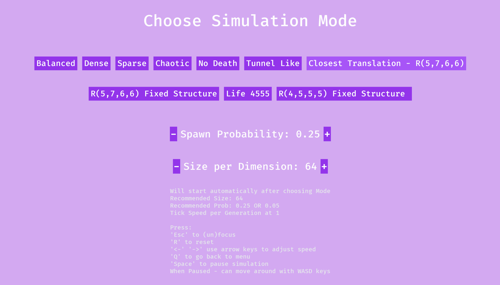

Menu - all parameters configurable, speed adjustable mid simulation

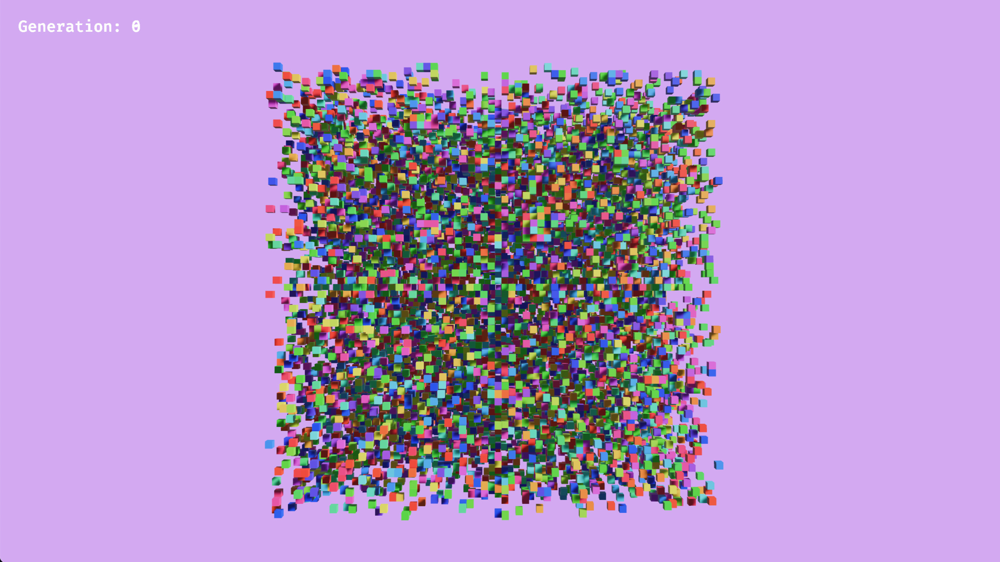

Initial state at 5% spawn prob.

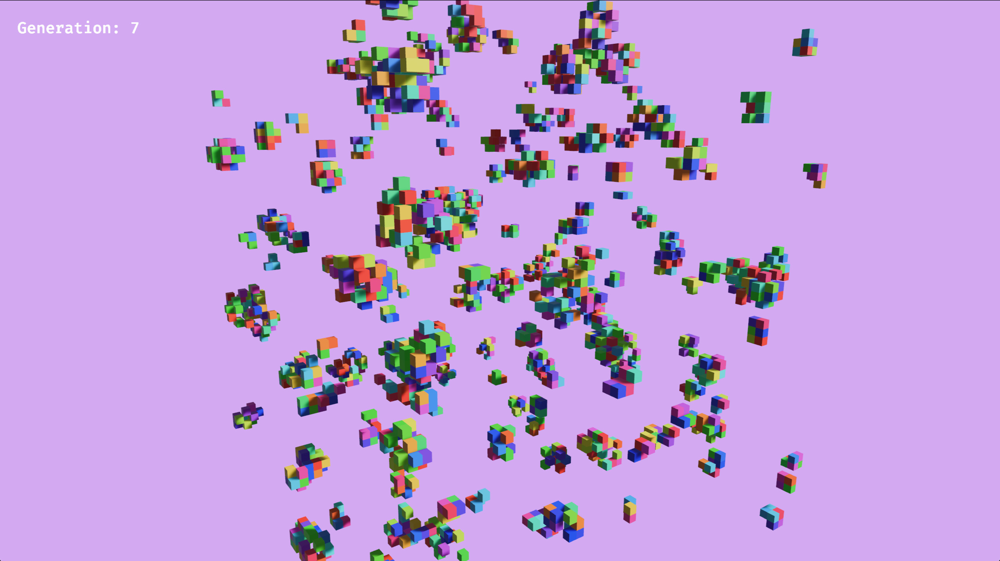

Balanced Rule with 5% spawn prob.

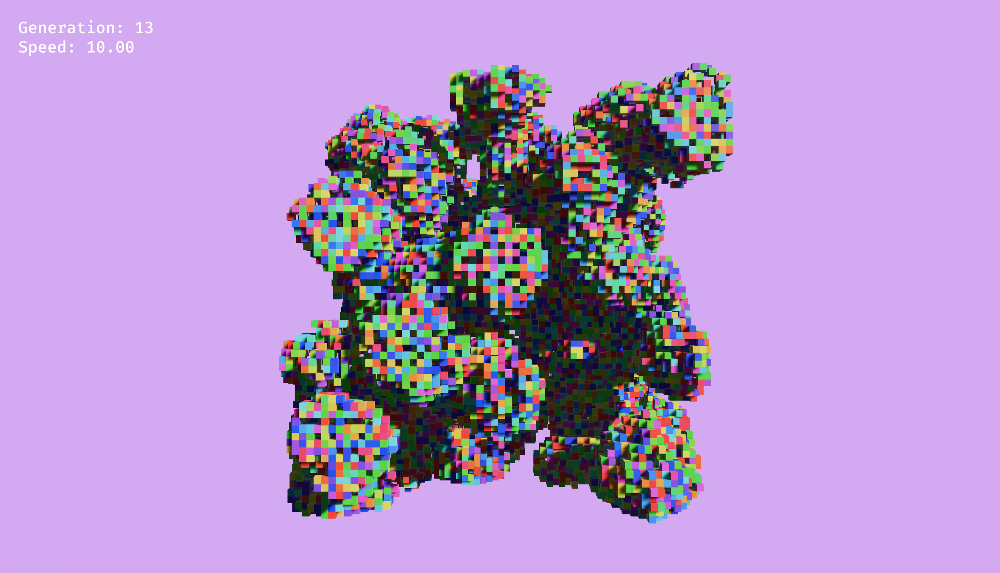

Dense Rule with 10% spawn prob.

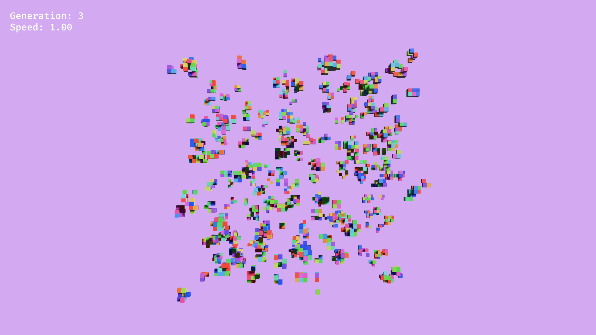

Sparse Rule with 5% spawn prob.

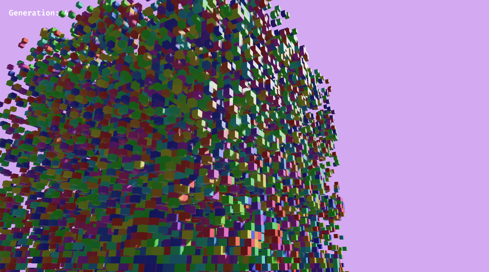

No Death Rule

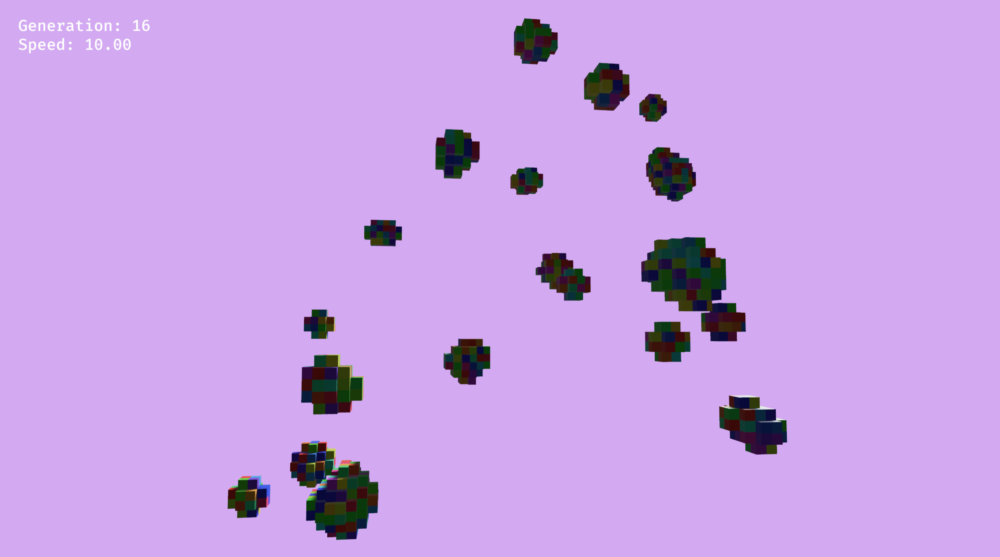

Tunnel Like with 25% spawn prob

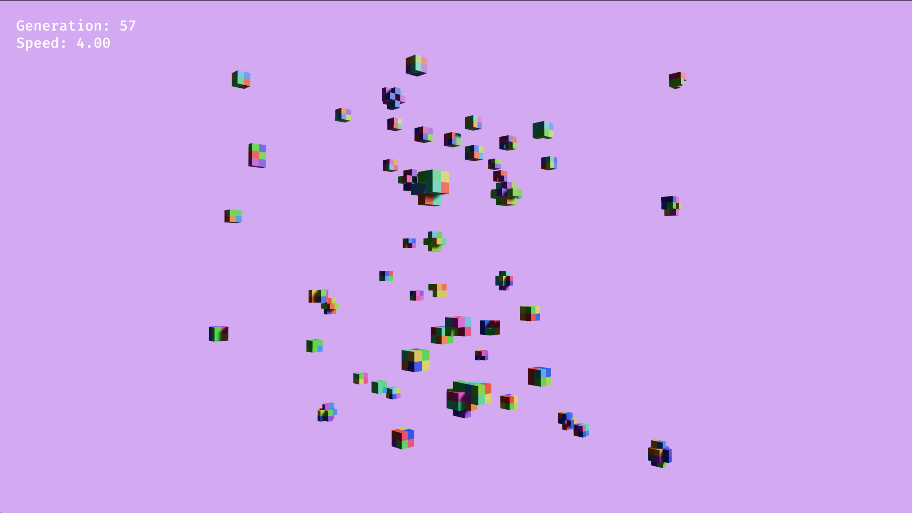

At 25% spawn. prob Rule (5,7,6,6) is the closest known rule for mimicking the results of the classic 2d variation of the experiment - detailed desc. in rules.rs

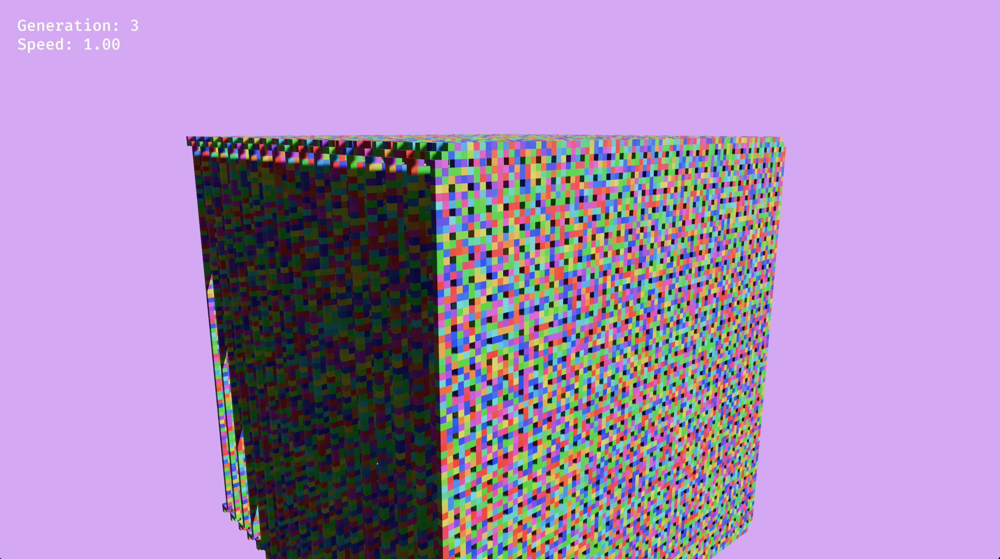

Same Rule - but fixed placed stable structure , creates stable parallel barriers between which mini simulations of a 3d conway universe can run simultaneously

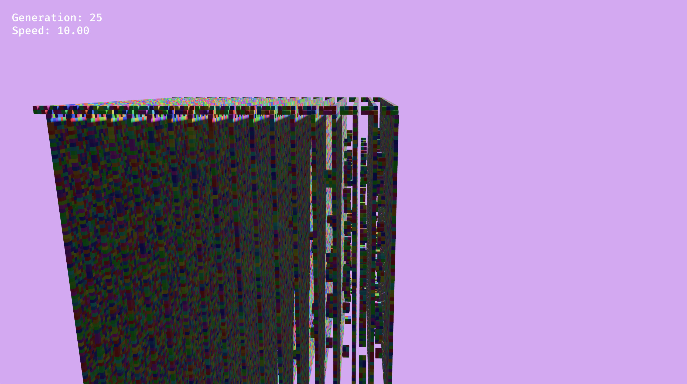

Mini stable structures converged from randomly generated cubes between parallel barriers

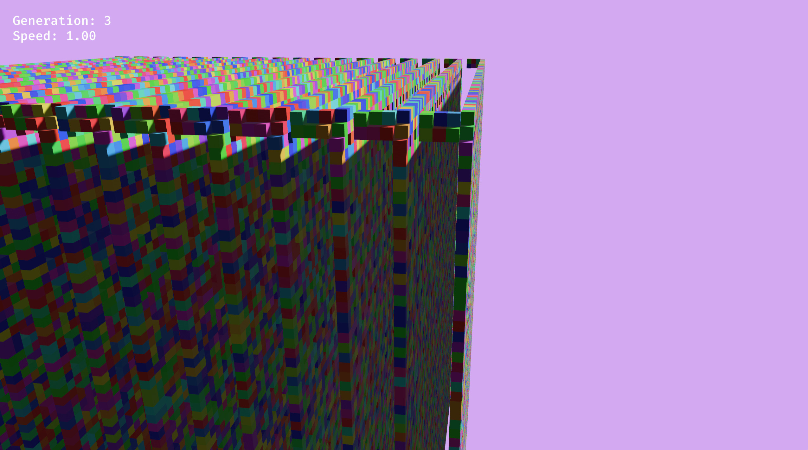

Empty side view

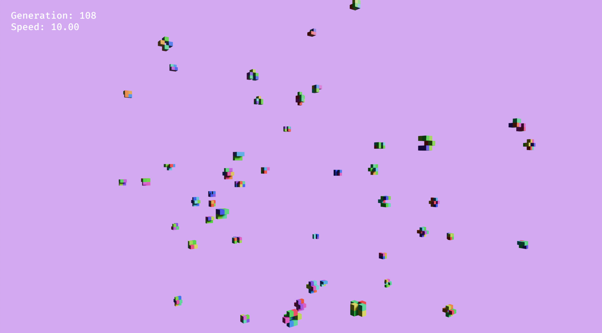

At 25% spawn. prob & R = (4,5,5,5) is a rule that produces semi-stable small structures that display symmetry

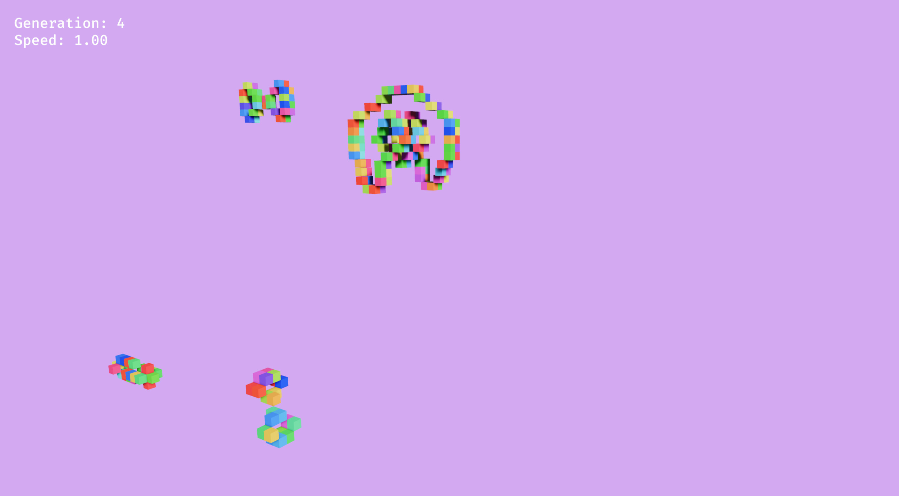

Same Rule - but fixed handplaced stable structures that would be almost impossible to find through randomness

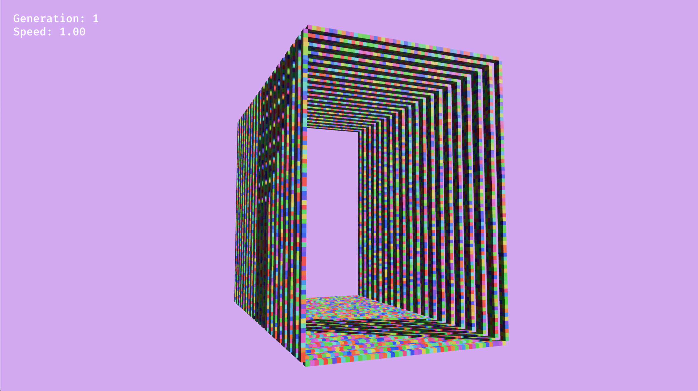

Misc. Unstable structures found - 1

 

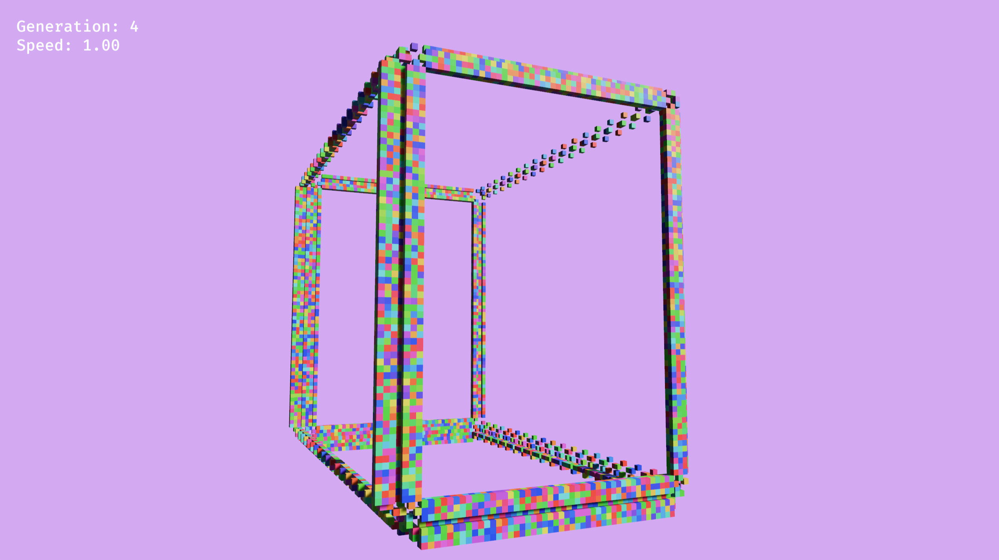

Misc. Unstable structures found - 2

## Install
clone repo and build (need rust compiler installed)

## Authors

* ThatLukaszGuy

